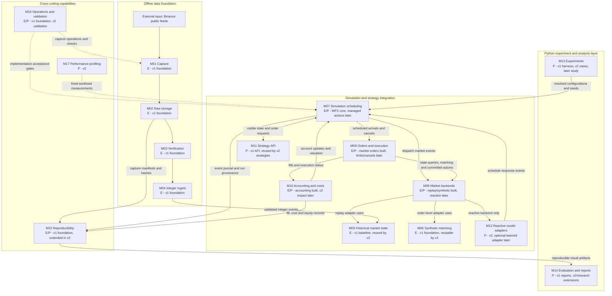
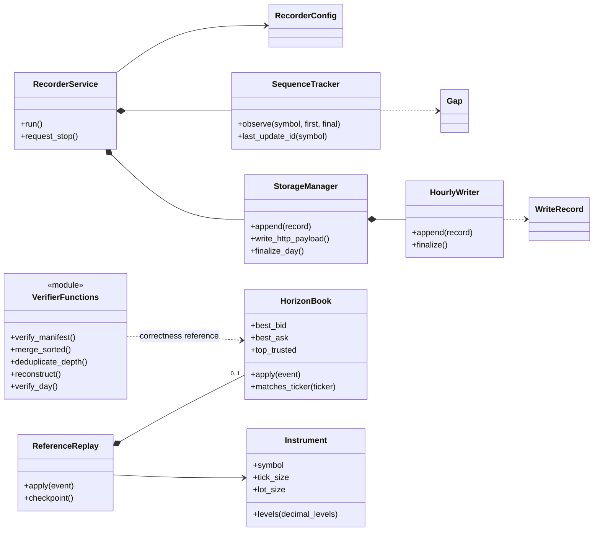
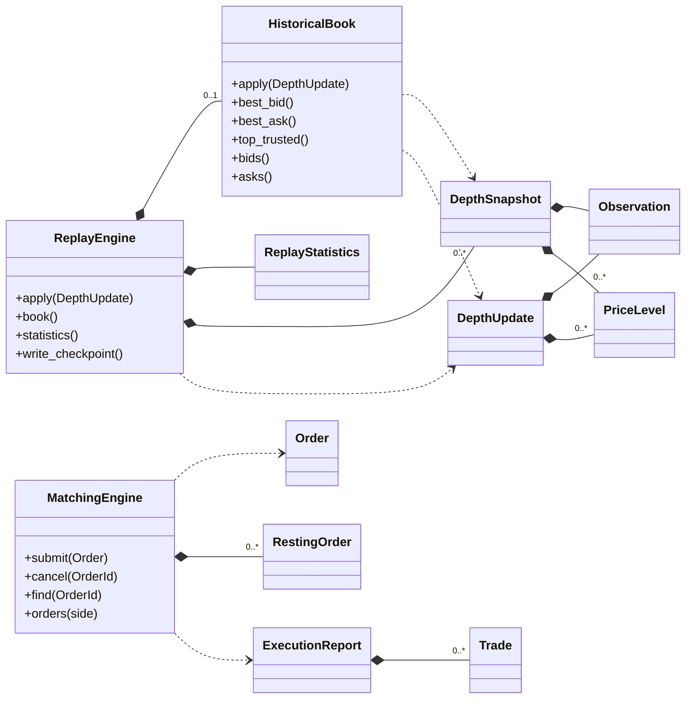
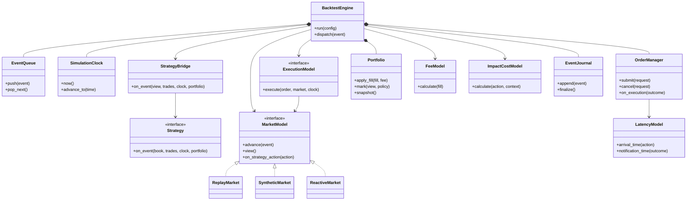
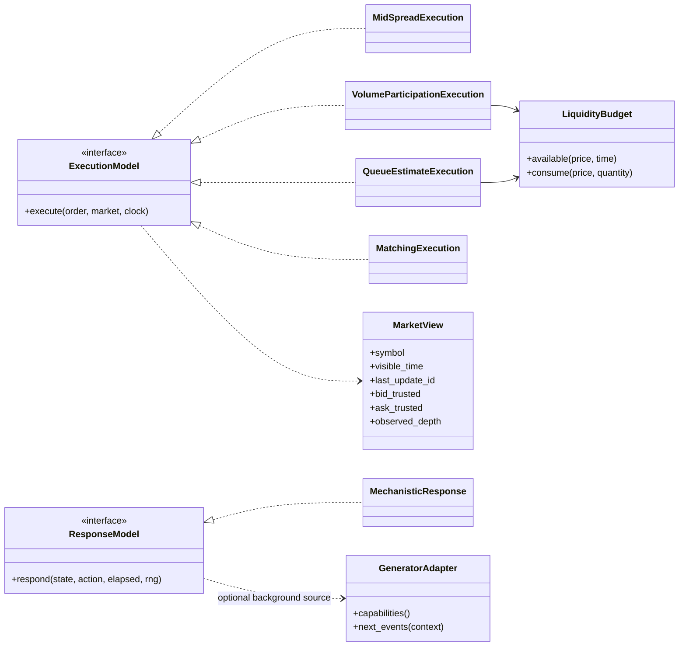
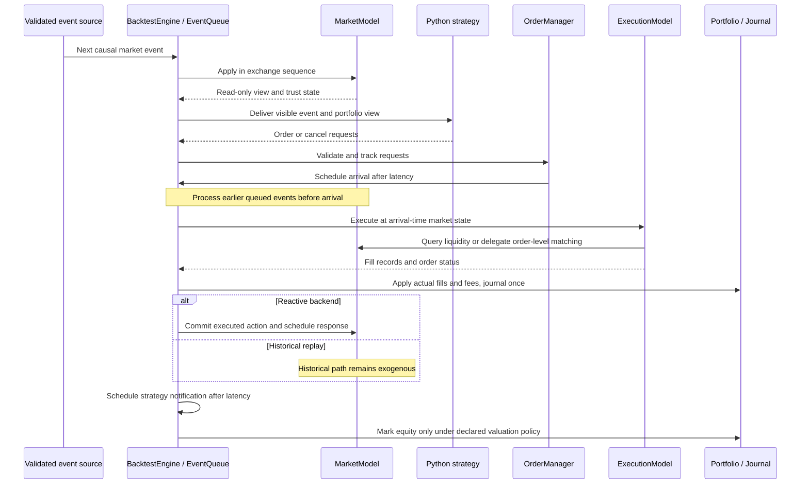
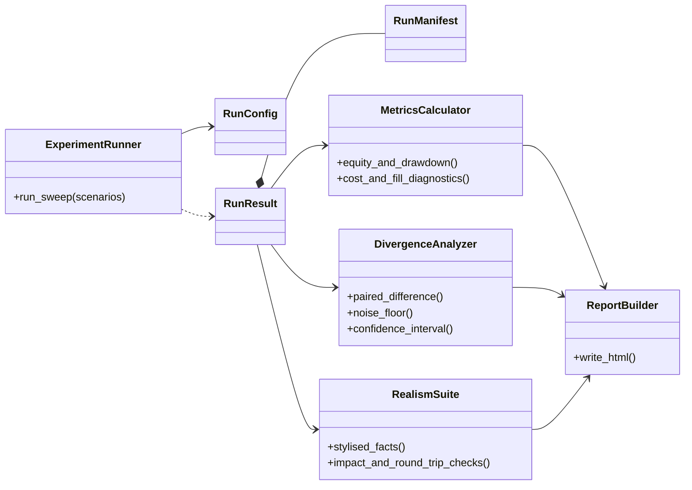

# COUNTERBACK: high-level system design

Design review: 8 November 2026. Based on the repository specification in
[README](../README.md), the [decision log](decision-log.md), the current Python
and C++ interfaces, and the separate local DiffLOB README. This document proposes
the complete backtesting architecture; it does not implement the missing modules.

**Status legend:** E = existing implementation; P = proposed; E/P = an existing
component needs a new adapter or extension. All unimplemented class names below
are design proposals, not claims about the current API. Diagrams are split by
responsibility to keep the class structure readable. Editable Mermaid sources
are in [diagrams/](diagrams/).

**Release scope is separate from implementation status.** The module table in
section 3 assigns responsibilities to v1, v2 or their shared foundation. A v1
label does not mean the component is already finished. The final research study
uses both releases and follows them; it is not another engine release.

WP1's baseline rules are frozen in the [v1 simulation contract](v1-execution-contract.md).
The [dataset preparation guide](dataset-preparation.md) describes the implemented
inventory/cache tooling; [WP1 validation](wp1-validation.md) records its measured
scope. [WP2 runtime and adapters](wp2-runtime.md) now implement causal scheduling,
immutable market views and initial journals. [WP3 market orders and accounting](wp3-market-orders.md)
now implement the first historical trading slice. Managed limit/cancel behavior,
delayed account knowledge and Python bindings remain later work.

The [class and data-type catalogue](#10-class-and-data-type-catalogue) describes
every class in the diagrams, the additional records named in this design, and
the existing supporting classes. Each entry states its responsibility, key
state or operations, and collaborators. Existing structs/dataclasses are included
because their contracts are as important as the service classes.

## 1. What the system must answer

COUNTERBACK measures how execution assumptions and the absence of market response
change a strategy's apparent performance. The system runs the same strategy and
scenario through controlled combinations of:

- historical replay, where strategy actions cannot change the recorded market;
- alternative execution fidelity, latency and transaction-cost assumptions;
- a reactive market, where a specified model changes subsequent market state;
- order size, independent days and random seeds, including a zero-size baseline.

Outputs are execution diagnostics, cash/inventory/equity histories, costs,
drawdown, performance statistics, uncertainty estimates and market-realism tests.
A market-state replay is a prerequisite, not a complete trading backtest.

The specification calls for Python strategies/configuration/experiments/analysis
and a C++ event-driven core, eventually connected through pybind11. Keep the
simulation core single-threaded and single-instrument initially. Capture runs
separately. No broker connectivity, live trading, multi-asset cross-impact or RL
agent is required. Monthly momentum and other long-horizon controls need data
beyond the one-day replay milestone.

## 2. System and module diagram

This diagram and the table in section 3 describe the **same 17 modules at the
same level of detail**. Each `M01`–`M17` box corresponds to exactly one table row
with the identical ID and name. Subgraphs group related modules; they are not
additional modules. Binance is an external input, not a module in the table.

Solid arrows show the main data/control relationships. Dashed arrows show
selected cross-cutting support relationships, not market-event messages. The
detailed event sequence is in section 6; the class-level decomposition is in
sections 4, 5 and 10. The offline path, WP2 scheduling/backend foundation and WP3
historical market execution/accounting are implemented; the full order lifecycle,
Python strategy integration and research/reporting remain proposed.



### 2.1 Reading the diagram against the module table

- **M01–M04** prepare verified integer inputs; **M05** reconstructs the historical
  book from them. M03 checks dataset quality; M16 provides operational and
  implementation validation across the system. These are different responsibilities.
- **M07** is the run coordinator. It schedules work for **M08**, exchanges
  strategy-visible information and requests through **M11**, and dispatches
  arrived actions to **M09**. **M10** applies accounting and valuation policies.
- **M08** is the backend/adapter module, not another book implementation.
  `ReplayMarket` uses M05; `SyntheticMarket` uses **M06**; `ReactiveMarket` uses
  **M12** for declared responses. Thus replay, synthetic and reactive are classes
  within the M08 module, rather than three extra module-table rows.
- **M13** sets up runs; **M14** analyzes and reports their results. They share
  **M15**, which provides existing input evidence plus proposed run manifests
  and journals. Reporting and reproducibility are separate responsibilities.
- **M15–M17** are cross-cutting capabilities. Only representative relationships
  are drawn: M15 covers input and run provenance, M16 also validates the data/
  matching/reactive components, and M17 profiles the relevant core paths rather
  than only the coordinator. These modules do not imply separate network services.

Names such as `RecorderService`, `ExecutionModel` and `ReportBuilder` identify
classes. Their assignment to modules is specified in
section 3's responsibility/status columns and described individually in section
10. In particular, capture (M01) delegates persistence to raw storage (M02);
orders and execution (M09) includes both order management and fill policies;
evaluation and reports (M14) includes both analyzers and report generation.

`MatchingEngine` (M06) remains independent of historical replay (M05). The
WP2 M08 adapters integrate them under a common contract without translating
Binance L2 deltas into matcher orders. An execution model may delegate to its
selected backend, but must not execute the same order in both a historical fill
approximation and the FIFO matcher. The M08–M12–M07 response path is used only by
a reactive backend; historical strategy actions do not change M05's market path.

## 3. Module responsibilities and implementation status

The IDs and module names below match the M01–M17 boxes in section 2 one-to-one.
Use a row to find the module's responsibilities, release assignment and concrete
classes/files; use the diagram to see how that module interacts with others.

| Module (diagram ID) | Responsibility and key elements | Version / release scope | Status / location |
| --- | --- | --- | --- |
| **M01 — Capture** | Public WebSocket/REST, receive timestamps, reconnects, gap observations, periodic snapshots and exchangeInfo | **v1 foundation**, reused by v2 | E: `src/depth_recorder/recorder.py`, `config.py`, `sequence.py` |
| **M02 — Raw storage** | WAL recovery, hourly zstd files, ledgers, final manifests and checksums | **v1 foundation**, reused by v2 | E: `src/depth_recorder/storage.py`, `jsonutil.py`, `models.py` |
| **M03 — Verification** | Merge recorder streams, detect conflicting duplicates, reconstruct, check tickers and coverage | **v1 foundation**, reused by v2 | E: functions in `verify.py`; `HorizonBook` in `book.py` |
| **M04 — Integer ingest** | Metadata validation, exact ticks/lots, deterministic export, inventory, preparation cache and reference comparison | **v1 foundation**, reused by v2; additional feed/generator adapters are extensions | E: `src/counterback_replay/export.py`, `dataset.py`; C++ `PreparedReplayReader` in `engine/src/prepared_replay.cpp` |
| **M05 — Historical market state** | Bootstrap, absolute L2 replacement, gaps, trust/horizon and crossed-book checks | **v1** replay state; retained as the v2 comparison baseline | E: `HistoricalBook`, `ReplayEngine`, `ReplayStatistics` |
| **M06 — Synthetic matching** | Individual order IDs, FIFO queues, limit/market orders, cancellation and fills | **v1 foundation**; reusable in compatible v2 order-level markets | E: `MatchingEngine` and structs in `types.hpp` |
| **M07 — Simulation scheduling** | One causal event queue, simulated clock, event priorities, delayed actions and deterministic dispatch | **v1 core**, reused by v2 to schedule responses | E: `BacktestEngine`, `EventQueue`, `SimulationClock`; managed order/account notifications remain WP4 |
| **M08 — Market backends** | Replay, synthetic order-level world and mechanistic reactive world behind one interface | **v1:** common interface, replay and synthetic adapters. **v2:** reactive backend | E: `MarketModel`, `ReplayMarket`, `SyntheticMarket`, `MarketView`; P: `ReactiveMarket` |
| **M09 — Orders and execution** | Strategy order lifecycle, rejects, cancellations, latency, fill assumptions, consumed liquidity | **v1:** working execution, slippage, lifecycle and latency contract. **v2 optional refinements:** participation/queue estimators requiring additional data | E: `MarketOrderExecution`, `LiquidityBudget`, `FillRecord`, `ExecutionOutcome`; P: `OrderManager`, `LatencyModel`, general `ExecutionModel`, limits/cancels |
| **M10 — Accounting and costs** | Fill-driven cash/inventory, fees, optional impact charges, valuation and attribution | **v1:** portfolio, fees, valuation and execution/slippage attribution. **v2:** explicit calibrated impact models | E: `Portfolio`, `PortfolioSnapshot`, `FeeModel`, `ValuationPolicy`, `MoneyGrid`, checked `Money`/`Exact`; P: reservations/delayed visible account, `ImpactCostModel` |
| **M11 — Strategy API** | Read-only book/trades/clock/portfolio; return market/limit/cancel requests | **v1:** Python API/bindings and intraday mean reversion. **v2:** monthly momentum control using the same API | P: Python `Strategy`, C++ `StrategyBridge`, pybind11 module |
| **M12 — Reactive model adapters** | Apply a declared response law; optionally consume validated learned background flow | **v2:** mechanistic response. **Optional v2/later:** learned scenario adapter; not a v1 gate | P: `ResponseModel`, `GeneratorAdapter`; no current DiffLOB integration |
| **M13 — Experiments** | Size/seed/day/model sweeps and paired replay/reactive runs | **v1:** baseline run/configuration harness. **v2:** paired reactive scenarios. **After v2:** full research sweeps | P: `ExperimentRunner`, `Scenario`, `RunConfig`, `RunResult` |
| **M14 — Evaluation and reports** | Equity/drawdown, costs/fills, Sharpe/Deflated Sharpe inputs, divergence, confidence intervals, realism scorecard | **v1:** trading diagnostics and results write-up. **v2:** response/realism diagnostics. **After v2:** final divergence statistics and scorecard | P: `MetricsCalculator`, `DivergenceAnalyzer`, `RealismSuite`, `ReportBuilder` |
| **M15 — Reproducibility** | Config, source hashes, code/environment/model versions, seeds, event/fill/accounting logs | **v1 core**, extended in v2 with response/model identities and reused for the final study | E: capture/export evidence, runtime/order/fill/fee/account/valuation journals; P: complete `RunManifest`, artifact-owning `EventJournal` |
| **M16 — Operations and validation** | systemd, offload/restore/pruning, health checks, offline tests, reference comparisons | **v1:** recorder/engine/accounting validation. **v2:** reactive-model and round-trip validation | E: `deploy/`, `.github/workflows/ci.yml`, CTest/Python suites including WP3 accounting reference; P: complete v1/external-engine and response validation |
| **M17 — Performance profiling** | Benchmark fixed workloads and identify time/memory costs in the C++ event loop, matching and replay paths | **v2**, as specified in the README roadmap | P: profiling/benchmark harness and recorded configurations; no dedicated implementation claimed |

### 3.1 Meaning of the release assignments

This is an explicit proposed allocation of the README roadmap to architectural
modules. Shared modules are built for v1 and reused or extended in v2, rather
than implemented twice. Within a mixed module, only the responsibilities labeled
v1 belong to its v1 release gate.

- **v1 is a usable historical backtester:** a strategy can submit orders, receive
  modeled fills, incur commissions/slippage, update cash/inventory and produce
  reproducible performance diagnostics. The reference strategy is intraday mean
  reversion. A book-replay CLI alone does not complete v1.
- **v2 extends the backtester:** add explicit impact models, a reactive market,
  a monthly-momentum control strategy and C++ profiling. Its acceptance checks
  must validate the added response behavior before research results rely on it.
- **Optional refinement is not a release promise:** the participation/queue
  models and learned generator adapter are extension designs. They need their
  own data/validation gates and are not prerequisites for the first working v1.
  A generator conditioned on the agent's own order flow remains outside the
  stated v1/v2 commitment.

For the class catalogue in section 10, use these assignments: the common runtime,
strategy bridge, order manager, liquidity/accounting policies and baseline run
records are v1 infrastructure; `ReactiveMarket`, `ResponseModel`,
`MechanisticResponse` and `ImpactCostModel` are v2 additions. `GeneratorAdapter`
is optional. Research analyzers are built incrementally as evaluation tooling;
their final study outputs belong to the subsequent research phase.

## 4. Existing class structure

### 4.1 Capture and the Python correctness reference

`verify.py` and the exporter are primarily functions, not service classes. The
diagram therefore labels them as modules rather than inventing existing
`Verifier` or `HistoricalDataReader` classes.



`Snapshot`, `DepthEvent` and `TickerEvent` are immutable Python input records.
`ReferenceReplay` is an export/test oracle, not the future backtest coordinator.
The exporter also reuses verifier readers and `exact_units`; it emits `events.l2`,
Python checkpoints and `evidence.json` for the C++ replay.

### 4.2 Existing C++ state and matching classes

These are separate libraries and separate state machines. There is intentionally
no `HistoricalBook -> MatchingEngine` relationship.



Binance L2 records change aggregate quantities; a reduction does not reveal
execution versus cancellation. FIFO priority for a strategy's passive order
cannot be recovered from that data. The existing matcher is appropriate when
the simulator actually has individual order-level events.

## 5. Proposed backtesting class structure

The diagram shows the target composition. WP2 implements `BacktestEngine`,
`EventQueue`, `SimulationClock`, `MarketModel`, `ReplayMarket` and `SyntheticMarket`.
WP3 adds `MarketOrderExecution`, `LiquidityBudget`, `Portfolio`, `FeeModel` and
`ValuationPolicy` outside the broader proposed execution hierarchy shown below.
Managed lifecycle/notifications, Python bridges and reactive models remain proposed.
Methods on those proposed components indicate responsibilities, not finalized
signatures; see [the runtime guide](wp2-runtime.md) and [WP3 guide](wp3-market-orders.md) for current APIs.



`ReplayMarket` wraps the existing replay controller; `SyntheticMarket` wraps the
existing matcher. `ReactiveMarket` owns a market state and a `ResponseModel` that
changes future state after a declared accepted strategy action. The first
mechanistic law can respond to executed flow only; responses to posting or
cancelling visible liquidity require an explicit richer law. Rejected requests
must not create market impact. It may reuse the matcher
only when its background input really is order-level flow. These are backend
adapters, not reasons to replace the validated existing classes.

### 5.1 Execution and reactive policies



- `MidSpreadExecution` is the deliberately crude benchmark. Exact fill-price and
  limit-order rules must be specified; the model must not silently fill any
  requested limit order merely because a midpoint exists.
- `VolumeParticipationExecution` caps eligible fills against a defined traded
  volume window. The current C++ export does not include trades: a causally
  ordered trade adapter is a prerequisite for this model.
- `QueueEstimateExecution` estimates passive fills on L2; uncertainty and its
  cancellation assumptions must be reported. Full queue-position validation
  needs a separate L3/LOBSTER adapter and order-level data.
- `MatchingExecution` delegates to the order-level market backend and translates
  its `ExecutionReport`/`Trade` into the common accounting records.
- `LiquidityBudget` prevents repeated simulated consumption of the same visible
  liquidity between exogenous updates. Its replenishment policy is explicit;
  it does not rewrite the immutable historical market path.
- A fee changes cash. Spread and book-walking slippage usually already enter
  through the execution price. A configured impact cost or reactive price
  response must have explicit attribution to prevent charging the same effect
  twice. Cost sensitivities are experiment parameters, not hidden constants.

### 5.2 DiffLOB's place in the design

The inspected local DiffLOB README describes trajectories conditioned on future
trend, volatility, liquidity and imbalance regimes. That is a useful optional
scenario/background generator. It is **not evidence of a model conditioned on
each submitted strategy order**, and no Counterback adapter exists yet.

The first genuinely reactive backend should therefore be mechanistic and
testable. A learned generator can be integrated only with a documented causal
contract: context, units, instrument/domain, state continuity, time resolution,
seed/checkpoint identity and supported conditioning. A future regime must be a
declared scenario input, never a label secretly derived from the evaluation
future. A prerecorded generated path alone remains generated replay. Training
an agent-order-conditioned generator is explicitly deferred in the specification.
The local LOBSTER/equity smoke work does not establish a BTCUSDT generator.

### 5.3 Shared data contracts

| Contract | Purpose |
| --- | --- |
| `MarketEvent` / `EventEnvelope` (P) | Tagged snapshot, depth, public trade or generated event; provenance, exchange sequence, simulation/availability times and validity. Wrap existing L2 records instead of changing their meaning. |
| `MarketView` (E) | Read-only observed depth, trusted horizons, sequence/time and instrument metadata; never expose future or private mutable state. |
| `OrderRequest` (P) | Strategy market/limit/cancel instruction; distinct from `DepthUpdate`. The manager owns IDs and lifecycle state. |
| `StrategyAction` (P) | Accepted posting/cancellation or execution committed by the simulator; the declared response model decides which action kinds affect the market. |
| `FillRecord` / `ExecutionOutcome` (E) | WP3 historical execution records with stable IDs, symbol, execution time, price/quantity, notional/fee and terminal status/reason. Journal role/model labels are modeled taker-like historical depth execution. Synthetic normalization remains an extension. |
| `PortfolioSnapshot` (E) / `CostBreakdown` (P) | WP3 authoritative cash/inventory, exact gross basis/P&L, separate fees, equity and valuation validity. Delayed strategy-visible snapshots and richer cost breakdown remain proposed. |
| `RunConfig` / `RunManifest` / `RunResult` (P) | Resolved assumptions, reproducibility identity and immutable logs/metrics/report references. |

Public recorded trades (`MarketTradeEvent`, proposed) differ from the current
matcher `Trade`, which names synthetic maker/taker orders. Neither is inferred
from an aggregate depth reduction. Supported event kinds and feed capabilities
must be checked when a run selects a fill model.

## 6. Event lifecycle and causality

This is a proposed sequence for a valid trading interval, not the current
`ReplayEngine` implementation. The event queue arbitrates intervening market
events, order arrivals, cancellations and fill notifications.



Required runtime rules:

1. **One deterministic event order.** WP1 freezes the queue key as
   `(simulation_time, causal_round, event_priority, insertion_sequence)`. Preserve
   exchange update-ID order within market events. Market updates precede order
   arrivals, then cancellations, notifications, strategy callbacks and valuation
   within a round. Same-time child work moves to a later round when its priority
   would otherwise place it before its parent. Within one action, commit fills
   before its reactive response. Never let Python callback duration or GPU wall
   time reorder simulated events. WP2 implements this queue and tests its ordering.
2. **Separate time meanings.** Keep exchange event time, recorder receive time,
   strategy visibility time, order arrival time and notification time distinct.
   The current replay is sorted by update IDs, not a trading latency clock.
   Combining recorder streams does not recover measured strategy network delay.
3. **No future leakage.** A strategy receives a read-only view at its visibility
   time; snapshot availability and feature windows must obey that time policy.
   Offline snapshot bridging alone does not prove an online-causal backtest.
   During notification latency, expose only the portfolio/order information the
   strategy could know; the authoritative exchange ledger may already differ.
4. **Validity travels with state.** Snapshot outer depth is unknown, not empty.
   Gaps invalidate trading until a valid resynchronization. Proposed default:
   fail/stop the trading segment on required-state trust loss; never use an old
   midpoint silently for fills or equity. Any alternative exclusion/restart rule
   must specify handling of inventory, pending orders and excluded returns.
5. **Accounting follows fills.** Accepting an order does not change position.
   Each fill/fee is applied once; partial fills, expired market remainders and
   cancellation races have explicit lifecycle transitions.
6. **Exact numeric boundary.** Retain validated ticks/lots. Introduce an explicit
   money scale and checked/wider notional arithmetic; multiplying two int64
   values is not automatically safe. Price, quantity, cash and fees have distinct
   units. Float analytics must not mutate the trading ledger.

The [WP1 contract](v1-execution-contract.md) now defines baseline availability,
delayed notification, L2 replenishment, taker-like/crossing-only execution,
fee rounding, valuation and trust-loss behavior. WP2 implements the scheduling/backend
foundation; WP3 implements historical market orders/accounting. Limits/cancels,
delayed account visibility and multi-day integration remain WP4–WP6 work. Optional queue-estimation refinements and response-law calibration
remain separate later decisions.

## 7. Experiment and reporting structure



Keep fill fidelity, fee/impact policy and market response as separate experiment
axes. Replay/reactive comparisons should share the strategy, initial state,
time horizon and all non-treatment assumptions. Order requests can subsequently
diverge because the same strategy sees different market paths; that is part of
the closed-loop result. Add fixed-action/metaorder experiments when the purpose
is to isolate a market-response law.

Pair seeds deliberately, use separate RNG streams for latency/background/response,
and compare with a zero-size noise floor. Uncertainty needs independent days and
seeds, not a claim that millions of within-day updates are independent samples.
Report failed realism checks and null divergence results. The README's proposed
NautilusTrader cross-check, stylised facts, square-root calibration and
round-trip/no-manipulation checks remain future validation work.

Every run bundle should contain resolved config, input/report hashes, code and
environment versions, instrument metadata, time/validity policies, seeds, model
checkpoint/adapter versions, event/order/fill/fee/equity logs and the HTML report.
Record an imported generator's sampled event tape when needed for reproducibility.
The core should replay an identical tape deterministically; a seed alone cannot
promise cross-hardware bit-identical floating-point model inference.

### 7.1 What the research experiments are, and when they happen

The research experiments are the systematic studies that use the completed
engine to answer the project's hypotheses. They are **not a third version of
the engine**. The README schedules v2 for February 2027 and the main experiments
for March–April 2027; those are roadmap targets, not claims of completion.
Baseline studies can start on v1, while replay-versus-reactive studies require
the relevant v2 behavior to have passed its validation gates.

| Study | Question / hypothesis | Controlled comparison and outputs | Dependency / phase |
| --- | --- | --- | --- |
| Execution and cost sensitivity | **H1:** how much does a frictionless or coarse execution model overstate strategy performance, especially with higher turnover? | Compare the same strategy/data under declared execution, fee and slippage settings. Report changes in net returns, equity/drawdown, cost attribution and fill diagnostics; sweep plausible cost parameters. | Can begin with **v1**; becomes part of the final write-up |
| Replay versus reactive size sweep | **H2:** how does performance/path divergence change as strategy order size increases? | Pair replay and reactive runs with common initial conditions and non-treatment assumptions; vary order size, days and seeds. Report divergence curves and uncertainty. Use fixed-action/metaorder tests separately to isolate the response law from strategy feedback. | Requires validated **v2**; main research phase afterward |
| Detectable-impact threshold | **H3:** below what order size is divergence indistinguishable from background simulation noise? | Establish a zero-size noise floor, then compare paired outcomes at increasing sizes. Report a threshold with confidence intervals, or explicitly report that no reliable threshold was identified. | Requires **v2** and sufficient independent days/seeds; main research phase afterward |
| Market-realism and robustness assessment | Are the modeled responses and generated paths credible enough to support the interpretation of H2/H3? | Compare declared stylised facts on real/simulated data, test stability and round trips, vary response parameters, and report failed checks alongside successes. Evaluate an optional generator only if actually integrated and validated. | Validation begins during **v2**; final scorecard is part of the research phase |

The intraday mean-reversion strategy and later monthly-momentum control help
compare a cost-sensitive strategy with a lower-turnover control. The latter
requires an appropriately long evaluation dataset; one verified day cannot
support a monthly strategy experiment. Fixed-action impact tests do not replace
the closed-loop strategy comparison, and a second strategy does not replace
independent-day evaluation.

Unit tests and model acceptance checks are different from these studies. Tests
establish that the implementation follows its declared rules; experiments measure
what those rules imply for the research question. Reproducing a square-root law
that was directly programmed into `MechanisticResponse` checks implementation,
not independent evidence that a real market would obey that model. Counterfactual
ground truth remains unavailable, so conclusions must state their model and
calibration dependence. Null results and failed realism checks remain reportable
research outcomes.

## 8. Physical boundaries and proposed package layout

Use a modular local application, not a network of simulation microservices.
Deployed recorder processes perform capture; restored immutable files cross into
offline verification/export. A local experiment process calls the C++ runtime
through bindings and writes run artifacts. Optional model generation may be
precomputed or isolated behind an adapter. The backtest has no broker endpoint.
Private raw backups continue through the existing configured rclone offload;
this diagram makes no claim about current remote host health.

```text
src/depth_recorder/              E  capture, storage, verifier, reference book
src/counterback_replay/          E  offline exact export and Python oracle
engine/include/counterback/     E  matching, historical state and replay APIs
engine/src/                     E  implementations above
engine/examples/                E  CLI readers and demonstrations
engine/tests/                   E  current deterministic/reference tests
engine/.../simulation/          P  queue, clock, coordinator, run policies
engine/.../execution/           P  order lifecycle, latency, fill models
engine/.../market/              P  replay/synthetic/reactive adapters
engine/.../accounting/          P  portfolio, valuation, fees, money arithmetic
bindings/                       P  pybind11 boundary
pyengine/                       P  public Python API and resolved run config
strategies/                     P  mean-reversion reference, later controls
experiments/                    P  reproducible scenarios and parameter sweeps
analysis/                       P  metrics, divergence, realism and reports
adapters/                       P  trade/L3 feeds and optional generator adapters
tests/                          E/P  Python tests; new backtest acceptance tests
deploy/                         E  recorder deployment, offload and pruning
docs/                           E  contracts, design, decisions and evidence
```

The proposed directories describe responsibility boundaries; they are not being
created as empty scaffolding by this design task. Generated runs, market data and
model weights stay outside source control. No database or web dashboard is needed
for the initial engine; logs and versioned artifact bundles are sufficient.

## 9. Implementation order and acceptance gates

The [v1 completion plan](v1-completion-plan.md) provides the current status audit,
remaining work packages and release checklist. This section also retains the
later v2/research stages so their separation from v1 remains explicit.

| Stage | Version / phase | Deliverable | Gate before progressing |
| --- | --- | --- | --- |
| Foundation, existing | **v1 foundation**, reused by v2 | Synthetic matching plus validated historical state | Existing reference tests and recorded replay evidence; retain L2/FIFO boundary |
| Next vertical slice | **v1** | Market-order-only replay backtest: clock, read-only strategy view, explicit depth fill/budget, portfolio and fees | Hand-worked fill/cash/position examples; trust-loss policy; deterministic logs; no look-ahead |
| Execution fidelity | **v1 core; optional v2 refinements** | Order lifecycle, limit/cancel support and latency; additional participation/queue estimators only with suitable data | Partial fills/expiry/cancel races; trade-feed alignment where required; L3 validation for queue claims; disclosed L2 uncertainty |
| Experiment baseline | **v1** | Reference mean reversion, cost sweeps, reproducible HTML reports | Same-config repeatability, accounting/cost attribution, independent-day evaluation |
| Reactive backend | **v2** | Mechanistic response law, explicit impact models and paired replay/reactive runs | Zero-size limit, configured impact response, stability and round-trip tests; no duplicated impact cost |
| Control strategy and profiling | **v2** | Monthly-momentum control and C++ time/memory profiling on fixed workloads | Sufficient long-horizon data; same strategy API/accounting; documented benchmark configuration and preserved correctness |
| Optional learned scenarios | **Optional v2/later** | Generator adapter and realism evaluation | Causal interface, domain/units/state continuity, pinned model/tape; no claim of order conditioning without evidence |
| Research conclusion | **After v2**; baseline work can start on v1 | Size/seed/day divergence experiments and final scorecard/write-up | Confidence intervals, noise floor, sensitivity and explicit failure/null reporting |

The next implementation should complete the market-order replay vertical slice.
Adding DiffLOB or passive FIFO assumptions before fills, accounting and time
semantics are validated would make the main experiment harder to interpret.

## 10. Class and data-type catalogue

E entries describe the inspected implementation. P entries describe proposed
responsibilities and candidate interfaces; they are not implemented APIs. An
interface or policy need not hold mutable state. Collaborator relationships do
not automatically imply ownership: the composition arrows in the class diagrams
identify ownership where it matters.

The **Version / release scope** column follows section 3: v1 is the first
intended release, while reuse or extension in v2 is stated explicitly. Optional
v2/later items are not mandatory v1 work. Research analyzers distinguish the v2
validation tooling from the main study after v2. These assignments do not change
the E/P implementation status, and they do not mean v1 has already shipped.
Diagram aliases and names that are not classes are labeled accordingly.

### 10.1 Capture, storage and verification — existing Python classes (E)

Sources: [recorder.py](../src/depth_recorder/recorder.py),
[config.py](../src/depth_recorder/config.py),
[sequence.py](../src/depth_recorder/sequence.py),
[storage.py](../src/depth_recorder/storage.py),
[models.py](../src/depth_recorder/models.py),
[book.py](../src/depth_recorder/book.py) and
[verify.py](../src/depth_recorder/verify.py).

| Class / record | Version / release scope | Description and responsibility | State, operations and collaborators |
| --- | --- | --- | --- |
| `RecorderService` | **v1 foundation**; reused by v2 | Coordinates raw Binance capture for one recorder process. Supervises WebSocket connections, REST snapshots/metadata, queued writes, heartbeats and day boundaries; it does not run strategies or maintain the replay book. | Owns a `StorageManager`, `SequenceTracker`, bounded write queue, run ID and freshness counters. `run()` starts its asynchronous tasks; `request_stop()` initiates orderly shutdown. Uses `RecorderConfig` and produces `WriteRecord` objects. |
| `RecorderConfig` | **v1 foundation**; reused by v2 | Immutable configuration for capture endpoints, instruments, storage, schedules and operational limits. Keeps deployment choices separate from recorder logic. | Holds recorder ID, symbols/streams, output path, timeout/reconnect settings and compression/health thresholds. Provides a canonical configuration hash and combined-stream URL; the heartbeat URL is resolved from the configured environment-variable name. |
| `SequenceTracker` | **v1 foundation**; reused by v2 | Tracks the greatest observed depth update ID per symbol and identifies observable forward sequence gaps during capture. It does not prove order-book correctness or repair missing messages. | `observe(symbol, first, final)` validates the range, updates the per-symbol cursor and optionally returns a `Gap`. `RecorderService` uses the result for gap evidence and resnapshot handling. |
| `Gap` | **v1 foundation**; reused by v2 | Immutable evidence that a received depth batch starts after the next expected update ID. | Stores symbol, previous final ID and the received first/final IDs. `missing_span` computes the number of absent IDs. Produced by `SequenceTracker`; used by capture diagnostics. |
| `StorageManager` | **v1 foundation**; reused by v2 | Organizes all recorder files by symbol, UTC date, stream and hour. Coordinates finalized streams, REST payload files, process/gap ledgers and manifests. | Owns active `HourlyWriter` objects and recorder/run/config identities. `append()` routes a `WriteRecord`; `write_http_payload()` stores snapshots/metadata; day-finalization operations close streams and build evidence. |
| `HourlyWriter` | **v1 foundation**; reused by v2 | Writes one hourly stream with a WAL-backed compressed partial file, then produces a finalized immutable stream. Recovers interrupted active writes before continuing. | Holds file/compressor handles, counts, receive-time/update-ID bounds and run identities. `append()` writes an envelope; `finalize()` returns finalized-file metadata for `StorageManager`. |
| `WriteRecord` | **v1 foundation**; reused by v2 | Immutable transport record between capture and storage. Carries the raw exchange payload inside the recorder envelope without converting it to a simulated order. | Contains symbol, stream, UTC/monotonic receive timestamps, envelope bytes, optional first/final IDs and run ID. Produced by `RecorderService`, queued and consumed by `StorageManager`/`HourlyWriter`. |
| `InputSource` | **v1 foundation**; reused by v2 | Identifies one restored recorder root for offline verification and export. | Immutable recorder ID and root path. Used by verifier readers, manifest checks and the exporter. Source-list order matters to the current snapshot-selection behavior. |
| `Snapshot` | **v1 foundation**; reused by v2 | Immutable Python representation of a REST L2 snapshot, retaining decimal text and capture provenance. Establishes the reference book's initial known horizon. | Contains symbol, last update ID, bid/ask tuples, recorder/run IDs and UTC receive time. Readers create it; `HorizonBook` and `ReferenceReplay` consume it. |
| `DepthEvent` | **v1 foundation**; reused by v2 | Immutable Python representation of an aggregate Binance diff-depth batch. Quantities specify replacements at prices, not additions or individual order instructions. | Holds symbol, first/final update IDs, decimal bid/ask updates, capture identity/timestamps and raw payload. Used by merging/deduplication, `HorizonBook` and export. |
| `TickerEvent` | **v1 foundation**; reused by v2 | Immutable public best-bid/ask observation used to check reconstruction at observable batch boundaries. It is validation evidence, not a fill instruction. | Contains symbol, update ID, decimal best prices/quantities and recorder/run/UTC provenance. `HorizonBook.matches_ticker()` compares it only when the reconstructed top is trusted. |
| `HorizonBook` | **v1 foundation**; reused by v2 | Python correctness reference for snapshot-anchored L2 reconstruction. Applies absolute quantities, removes zero quantities, checks sequence/crosses and preserves unknown outer depth. | Owns decimal price-level maps, best-price heaps, snapshot boundaries, trusted-level counts and last update ID. `apply()` consumes `DepthEvent`; trusted best-price access and `matches_ticker()` support the verifier. |
| `ApplyResult` | **v1 foundation**; reused by v2 | Per-update diagnostic result from Python `HorizonBook.apply()`. Separates harmless removal of an unseen level from a structural replay error. | Holds unseen-removal and outer-unseen-removal counts. The verifier and `ReferenceReplay` aggregate them into reconstruction summaries. |
| `depth_recorder.book.BookDataError` | **v1 foundation**; reused by v2 | Python exception for invalid book data or reconstruction, such as malformed decimal values, sequence gaps or crossed trusted prices. | Extends `ValueError`; it owns no simulation state. Reconstruction code catches it and invalidates the current segment rather than treating the failed book as trustworthy. |
| `GeoBlockedError` | **v1 foundation**; reused by v2 | Signals that capture encountered a geographically restricted Binance endpoint. | Extends `RuntimeError`; used by recorder endpoint handling so this operational failure is distinguished from an ordinary reconnect. It is not a request to use authenticated trading endpoints. |
| `JsonLogFormatter` | **v1 foundation**; reused by v2 | Formats capture diagnostics as structured JSON log records, including attached context and exception information. | Implements `format(record)` for Python logging and is installed by recorder logging setup. It does not store market state or make data-quality decisions. |

### 10.2 Export, preparation and policy primitives — existing Python types (E)

Sources: [export.py](../src/counterback_replay/export.py),
[dataset.py](../src/counterback_replay/dataset.py) and
[contract.py](../src/counterback_replay/contract.py). Manifest checking, inventory,
preparation, file export and comparison remain module functions. Policy types
specify contracts; they do not implement the proposed trading runtime.

| Class | Version / release scope | Description and responsibility | State, operations and collaborators |
| --- | --- | --- | --- |
| `Instrument` | **v1 foundation**; reused by v2 | Immutable instrument grid used at the decimal-to-integer boundary. Ensures prices and quantities can be represented exactly in ticks/lots. | Stores symbol, tick size and lot size. `levels()` invokes exact integer conversion with grid/bounds checks. The exporter derives it from validated captured exchangeInfo; it does not contain a trading strategy or fee model. |
| `ReferenceReplay` | **v1 foundation**; reused by v2 | Python oracle for the C++ replay export. Mirrors the verifier's snapshot scheduling while delegating actual book semantics to `HorizonBook`. | Holds the instrument, snapshot list/cursor, optional book, previous event and aggregate counters/intervals. `apply()` advances reference state; `checkpoint()` produces comparable output. It is not the proposed `BacktestEngine`. |
| `SimulationPolicy` | **v1 foundation**; v2 semantics need explicit versioning | Immutable WP1 baseline policy, separating semantic identifiers from configurable fee/latency/precision/warmup inputs. It explicitly reports that the trading runtime is not yet implemented. | Validates supported policy names, numeric bounds and benchmark fee rate; `to_dict()` exposes assumptions and event priorities. Consumed by policy examples/tests and future runtime configuration, not by the current C++ matching engine. |
| `ScheduleKey` | **v1 foundation**; reused by v2 | Immutable ordered key defining deterministic event time, causal round, priority and insertion order. It prevents zero-latency child actions from appearing before their triggering event. | Validates unsigned time/round/sequence and an `EventPriority`. `schedule_key()` creates keys relative to a current event. WP2 implements the same key and causal helpers in C++, enforced by `EventQueue`. |
| `EventPriority` | **v1 foundation**; reused by v2 | Existing Python enum defining WP1's market/arrival/cancel/notification/strategy/valuation/end ordering. It is a policy enum, not a service class. | Used by `ScheduleKey`, the policy serializer and causal tests; WP2 C++ dispatch implements these priorities and causal rounds, with differential checks against the Python keys. |

### 10.3 Historical replay — existing C++ classes and structs (E)

Sources: [historical_book.hpp](../engine/include/counterback/historical_book.hpp)
and [replay_engine.hpp](../engine/include/counterback/replay_engine.hpp).

| Class / struct | Version / release scope | Description and responsibility | State, operations and collaborators |
| --- | --- | --- | --- |
| `PriceLevel` | **v1 foundation**; reused by v2 | Integer price/aggregate-quantity pair shared by historical snapshots and updates. Quantity zero can represent removal in an update. | Stores `Price` ticks and `Quantity` lots; supports equality comparison. It contains no order IDs or FIFO positions. Used by `DepthSnapshot`, `DepthUpdate` and best-price results. |
| `Observation` | **v1 foundation**; reused by v2 | Preserves event provenance and timestamp meanings without imposing a simulation clock. | Stores UTC/monotonic receive nanoseconds, exchange event milliseconds and recorder/run IDs. Missing times use the current zero convention. Embedded in `DepthSnapshot` and `DepthUpdate`; monotonic times are scoped to a recorder/run pair. |
| `DepthSnapshot` | **v1 foundation**; reused by v2 | Integer snapshot input for historical reconstruction, corresponding to Python `Snapshot` after validated conversion. | Holds symbol, last update ID, bid/ask `PriceLevel` vectors and `Observation`. `ReplayEngine` selects a bridge snapshot; `HistoricalBook` loads its state and horizon boundaries. |
| `DepthUpdate` | **v1 foundation**; reused by v2 | Integer aggregate depth batch for C++ replay, corresponding to Python `DepthEvent`. | Holds symbol, first/final IDs, bid/ask replacement vectors and `Observation`. `ReplayEngine` checks ordering/duplicates and passes applicable batches to `HistoricalBook`. It must not become a matcher `Order`. |
| `HistoricalBook` | **v1 foundation**; reused by v2 | Maintains observed aggregated L2 state for one snapshot-anchored segment. Reconstructs market state without inventing order-level queues. | Owns ordered bid/ask maps, symbol, update cursor and original snapshot boundaries. `apply()` handles absolute changes and checks gaps/crosses; best-price methods suppress a side when its known horizon is exhausted. |
| `DepthApplyResult` | **v1 foundation**; reused by v2 | C++ per-update counterpart of Python `ApplyResult`. | Stores unseen and outer-unseen removal counters returned by `HistoricalBook.apply()`. `ReplayEngine` adds these to `ReplayStatistics`; the result is not a trade or execution report. |
| `counterback::BookDataError` | **v1 foundation**; reused by v2 | C++ exception for malformed depth input or invalid reconstruction state. | Extends `std::invalid_argument`; distinct from the Python exception with the same short name. `ReplayEngine` discards failed books for recoverable structural cases; the CLI reports invalid input/failure through its exit contract. |
| `ReplayEngine` | **v1 foundation**; reused by v2 | Controls deterministic historical reconstruction across snapshots and depth batches. Handles duplicate/stale events, bridge selection, gaps, invalid segments and recovery. | Owns snapshots/cursor, previous update, optional `HistoricalBook`, status and `ReplayStatistics`. `apply()` advances state; `write_checkpoint()` emits diagnostics. It has no strategy clock, order manager or portfolio. |
| `ReplayStatistics` | **v1 foundation**; reused by v2 | Aggregates historical replay outcomes and validity evidence. | Stores event/application/duplicate/stale/unanchored counts, snapshot segments, sequence gaps, removals, last depth ID, trusted/invalid/gap intervals and structural errors. Owned and updated by `ReplayEngine`. |

### 10.4 Synthetic matching — existing C++ classes and structs (E)

Sources: [matching_engine.hpp](../engine/include/counterback/matching_engine.hpp)
and [types.hpp](../engine/include/counterback/types.hpp).

| Class / struct | Version / release scope | Description and responsibility | State, operations and collaborators |
| --- | --- | --- | --- |
| `MatchingEngine` | **v1 foundation**; reused by v2 | Matches individual synthetic limit/market orders using price priority, FIFO within a price, maker-price execution and partial fills. Cancels resting remainders by ID. | Owns bid/ask maps of FIFO lists, an open-order index and a lifetime used-ID set. `submit()` returns `ExecutionReport`; `cancel()`, `find()` and `orders()` expose controlled operations. Used by the proposed `SyntheticMarket`, never fed raw L2 deltas. |
| `Order` | **v1 foundation**; reused by v2 | Individual order submission accepted by the current matcher API. It represents trader intent, unlike an aggregate depth update. | Stores ID, side, type, price ticks and quantity lots. Limit prices/quantities must be positive; market price must be zero. Validation and ID acceptance are the matcher's responsibility. |
| `RestingOrder` | **v1 foundation**; reused by v2 | Snapshot of a limit order's outstanding remainder after matching. | Holds ID, side, price and remaining lots. The matcher stores these in FIFO queues; `find()` and `orders()` return value snapshots rather than mutable access to those queues. |
| `Trade` | **v1 foundation**; reused by v2 | One actual synthetic maker/taker match produced by `MatchingEngine`. | Holds maker/taker IDs, aggressor side, execution price and quantity. Included in `ExecutionReport` in execution order. It is distinct from the proposed public `MarketTradeEvent` and from an inferred L2 size reduction. |
| `ExecutionReport` | **v1 foundation**; reused by v2 | Complete immediate result of one current matcher submission. Reports both executions and the unfilled remainder. | Contains order ID, `OrderStatus`, executed/remaining lots and a vector of `Trade` records. A partially filled market remainder expires; an unfilled valid limit remainder rests. `MatchingExecution` would normalize this for future accounting. |
| `MatchingEngine::Location` | **v1 foundation**; reused by v2 | Private implementation helper for finding a resting order without scanning FIFO queues. It is not a public subsystem or strategy-facing record. | Stores side, price and an iterator to the order's FIFO-list node. Values live in the matcher's open-order index and support efficient lookup/cancellation. |

`OrderSide`, `OrderType` and `OrderStatus` are existing enums, not service
classes. `OrderId`, `Price` and `Quantity` are numeric aliases; `UpdateInterval`
is an update-ID pair. `Queue`, `Bids`, `Asks` and `HistoricalBook::Levels` are
container aliases. The current matcher status enum describes filled/resting/
expired submission results; the proposed manager must define its additional
pending, rejected and cancelled lifecycle states explicitly.

### 10.5 Simulation coordination and strategy integration — existing and proposed

| Class / interface | Version / release scope | Description and responsibility | State, operations and collaborators |
| --- | --- | --- | --- |
| `BacktestEngine` (E/P) | **v1 core**; reused by v2 | Coordinates a single-use causal run, readiness, trust-loss halts and WP3 historical market orders/accounting. | Owns queue/clock, optional account and journal sink; references one backend. `RuntimeConfig.account` enables historical `submit_after()`; `portfolio()` is authoritative const state. `cancel_after()` remains synthetic-only. Managed limit/cancel lifecycle and notifications remain WP4. |
| `EventQueue` (E) | **v1 core**; v2 also schedules response events | Schedules market events and simulated actions in a stable total order. Ensures an intervening market event is processed before an order whose arrival is later. | Holds pending `EventEnvelope` values ordered by simulation time, causal round, event priority and insertion sequence. `push()` schedules work; `pop_next()` selects the next event. Used by `BacktestEngine`, including for latency and response events. |
| `SimulationClock` (E) | **v1 core**; reused by v2 | Represents simulated time independently of real execution speed or wall-clock sleeps. | Holds the current logical time and advances monotonically to the next queued event. Read by strategies, order/execution models and response policies; only the coordinator should control advancement. |
| `StrategyBridge` | **v1**; reused by v2 strategies | Adapts the C++ runtime to the Python strategy interface through the proposed pybind11 boundary. | Holds a strategy reference and performs explicit conversion/lifetime management for read-only views and returned requests. `on_event()` passes only information visible at that simulation time and validates returned request types. |
| `Strategy` | **v1** API/mean reversion; **v2** momentum control uses it | Python user-facing algorithm interface. Observes permitted state and returns trading intent; it does not execute orders or directly mutate the book or portfolio. | Candidate method is `on_event(book, trades, clock, portfolio) -> orders`. Concrete strategies may own indicators/history and deterministic strategy-local state. Each run receives a fresh instance to prevent state leakage between experiments. |
| `OrderManager` | **v1 core**; reused by v2 | Owns the full simulated order lifecycle and stable ID mapping across requests, acceptance, partial fills, cancellation, rejection and expiry. | Holds outstanding orders, remaining quantities and pending actions. Validates/records `OrderRequest`, schedules arrival through `LatencyModel`, and reconciles `ExecutionOutcome`. Must distinguish authoritative exchange state from delayed strategy notifications. |
| `LatencyModel` | **v1** latency contract; reused by v2 | Determines when submitted actions reach the simulated market and when outcomes become visible to the strategy. | Holds configured delay parameters and, if stochastic, a dedicated seeded RNG stream. Computes arrival/notification times; `EventQueue` enforces them. It must not use actual callback or inference duration as simulated delay. |
| `EventJournal` | **v1 core**; v2 adds response/model evidence | Produces an ordered audit trail sufficient to diagnose and reproduce a backtest's state transitions. | Appends versioned market/order/fill/fee/valuation/validity events with stable IDs and logical times, then finalizes artifact references/hashes. Receives committed events from the coordinator; it does not independently change simulation state. |

### 10.6 Market backends and reaction models — existing and proposed

| Class / interface | Version / release scope | Description and responsibility | State, operations and collaborators |
| --- | --- | --- | --- |
| `MarketModel` (E) | **v1** common interface; extended for **v2** reaction | WP2 interface separating pending input lookahead from publishing a currently available read-only book. Keeps the coordinator independent of replay versus synthetic matching. | `next_event()`, `advance(event, now)`, `view()`, `capabilities()`; order-level `submit()` / `cancel()` are supported only by `SyntheticMarket`. Committed reactive actions remain v2. |
| `ReplayMarket` (E) | **v1**; retained as the v2 baseline | Adapts the existing `ReplayEngine`/`HistoricalBook` into the WP2 runtime while keeping recorded market evolution exogenous. | Owns or references replay state and maps it into `MarketView`, including trust/horizon metadata. Strategy actions never rewrite its historical path; simulated consumed liquidity is handled under the execution/budget policy. |
| `SyntheticMarket` (E) | **v1** order-level adapter; reusable by compatible v2 backends | Presents an individual-order market using the existing FIFO `MatchingEngine`. Supports tests/scenarios where genuine order-level background events are known. | Owns a matcher and accepts appropriately typed order/cancel events. WP2 dispatches scheduled synthetic submissions/cancels to it; the proposed `MatchingExecution` can later delegate to the same adapter. It does not manufacture individual order IDs from aggregate Binance quantities. |
| `ReactiveMarket` | **v2** | Maintains a market whose subsequent state can change in response to committed strategy actions under a declared model. | Owns market state, a `ResponseModel` and any pending response events. Accepts only model-supported action kinds and schedules resulting changes through the common event order. May use an order-level backend only with compatible background events. |
| `ResponseModel` | **v2** | Interface describing the market's modeled response to an accepted action and elapsed time. Separates endogenous state evolution from execution-price approximations and cash charges. | Candidate `respond(state, action, elapsed, rng)` returns declared response events. It may be stateful, but its supported action kinds, calibration and RNG behavior must be explicit. Used by `ReactiveMarket`. |
| `MechanisticResponse` | **v2** | First concrete reactive policy, using a specified and testable response law rather than a learned generator. | Holds configured response/decay parameters and any impact history required by the chosen law. Can initially react to executed flow only; richer posting/cancellation responses require explicit support and validation. |
| `GeneratorAdapter` | **Optional v2/later**; not a v1 gate | Optional boundary around an external generator or a pinned generated event tape. Translates supported model inputs/outputs into simulator-compatible background/scenario events. | Exposes `capabilities()` and `next_events(context)` with units, timing, context, seed/checkpoint identity and continuity checks. Works with a compatible response backend; an adapter alone does not make DiffLOB agent-order-conditioned. |

### 10.7 Execution, liquidity, accounting and costs — existing and proposed

| Class / interface | Version / release scope | Description and responsibility | State, operations and collaborators |
| --- | --- | --- | --- |
| `MarketOrderExecution` (E) | **v1 WP3** historical market orders | Executes an arrived market request against trusted visible depth and a separate consumption budget, with whole-order funding validation and immediate remainder expiry. | `observe()` resets applied absolute price observations/replacing snapshots; `execute()` stages fills/budget and atomically applies the portfolio; `terminate()` expires pending actions. Owns lifetime IDs and the budget. General limit/cancel lifecycle remains WP4. |
| `ExecutionModel` | **v1** interface; supports v2 refinements | Common policy for turning an arrived order and current market state into execution/status outcomes. Defines fill assumptions independently of the strategy. | Candidate `execute(order, market, clock)` produces `ExecutionOutcome`. Concrete implementations read `MarketView`, consume a declared liquidity budget or delegate to order-level matching. They must report uncertainty and unsupported capabilities. |
| `MidSpreadExecution` | **v1** coarse execution benchmark | Deliberately coarse execution benchmark based on a declared midpoint/spread rule. Useful as a comparison against richer models, not evidence of queue realism. | Holds price/eligibility assumptions. Reads trusted top-of-book data at arrival time and emits normalized fills. Limit-order behavior and liquidity constraints must be specified rather than automatically filling all requested limits. |
| `VolumeParticipationExecution` | **Optional v2 refinement**; requires aligned public trades | Limits simulated fills to a configured share of eligible public traded volume over a defined window. | Maintains or queries eligible-volume usage and a `LiquidityBudget`. Requires aligned `MarketTradeEvent` inputs and an explicit allocation/window rule; cannot operate faithfully from the current depth-only C++ export. |
| `QueueEstimateExecution` | **Optional v2 refinement**; requires explicit queue/data assumptions | Estimates passive limit-order execution when only aggregate L2 state and, where available, trades are observed. | Tracks estimated quantity ahead, own remainder, cancellations/consumption assumptions and budget usage. Emits model-qualified fills; observed depth reductions alone cannot establish whether an actual execution occurred. |
| `MatchingExecution` | **v1** order-level execution adapter; reusable by v2 | Uses actual synthetic order-level matching as its execution mechanism. Converts backend results into the common backtesting contracts. | Delegates an arrived order to `SyntheticMarket`/`MatchingEngine`, then translates `ExecutionReport` and `Trade`. It must not also apply a separate L2 fill approximation to the same order. |
| `LiquidityBudget` (E) | **v1** execution foundation; reused by v2 | Tracks simulated consumption independently of the historical book. | Owns consumed quantity by side/price. `available()` / `consume(fill, observed)` check quantities; `observe()` resets only named absolute observations or all prices on snapshot replacement. |
| `Portfolio` (E) | **v1 core**; reused by v2 | Authoritative cash-funded long-only account with fill-driven cash, inventory, gross weighted-average basis/P&L and separate fees. | `apply(outcome)` validates every fill/fee and checks duplicate IDs before committing; `snapshot(view)` delegates to `ValuationPolicy`. Uses checked `MoneyGrid`/`Money` and rational `Exact`. Reservations/delayed strategy knowledge remain WP4. |
| `FeeModel` (E) | **v1**; reused by v2 | Calculates exact quote-currency taker benchmark charges. | `cumulative_fee(notional)` uses a configured exact rate and per-order ceiling; execution charges each fill's increase. Fees are separate from spread/depth effects already in execution prices. |
| `ImpactCostModel` | **v2** explicit impact policy | Optional explicit impact-cost policy for experiments that represent impact as an additional modeled charge or execution-price adjustment. | Holds the selected fixed/square-root/optional decay-law parameters and required context/history. Produces attributed cost components. Its configuration must reconcile with execution slippage and reactive market response to avoid double counting. |
| `ValuationPolicy` (E) | **v1**; reused by v2 | Marks long inventory at the current trusted best bid without assuming a terminal liquidation. | `mark(state, grid, view)` returns equity and exact unrealized gross P&L, or null/invalid valuation after required trust loss. Arithmetic overflow fails explicitly. |

### 10.8 Experiments, evaluation and reports — proposed classes (P)

| Class / record | Version / release scope | Description and responsibility | State, operations and collaborators |
| --- | --- | --- | --- |
| `ExperimentRunner` | **v1** baseline harness; **v2** paired runs; full study after v2 | Expands research scenarios into individual backtest runs and orchestrates controlled comparisons. Keeps experiment logic outside the per-event C++ hot path. | Uses `Scenario`/`RunConfig`, creates fresh runtime/strategy instances, assigns paired RNG streams and collects `RunResult` artifacts. Runs size/day/seed/model sweeps and invokes analysis/reporting. |
| `Scenario` | **v1** baseline cases; **v2** reactive cases; later research sweeps | Describes one research case or family of comparable runs: data interval, initial conditions, strategy and treatment axes. | Holds scenario identity and experimental intent, such as replay-versus-reactive comparison or a fixed metaorder size sweep. `ExperimentRunner` resolves it into concrete `RunConfig` values; it does not hold live book state. |
| `RunConfig` | **v1 core**; v2 adds response/model configuration | Fully resolved specification of one simulation run, separated from mutable runtime state. | Contains input/instrument references, starting balances, interval/warmup, strategy/model parameters, seed assignments and time/validity policies. Validated before execution and recorded in `RunManifest`. |
| `RunManifest` | **v1 core**; v2 adds response/model provenance | Reproducibility/provenance record for a completed or failed run. Explains exactly which inputs and assumptions produced its outputs. | Records config/input/report hashes, code/environment/model versions, seeds, policies and artifact identities. Belongs to `RunResult`; differs from recorder daily file manifests and the existing export `evidence.json`. |
| `RunResult` | **v1 core**; extended for v2 and reused in research | Immutable outcome bundle for one attempted run, including failure or excluded-interval evidence rather than only headline performance. | References its manifest, status, validity coverage, event/fill/accounting artifacts and computed results. Passed to metrics, divergence and realism analyzers; it need not load every event into memory. |
| `MetricsCalculator` | **v1** trading diagnostics; extended in v2 and later research | Computes trading/accounting diagnostics from committed result artifacts. Keeps analytical floating-point calculations outside the exact trading ledger. | Produces equity/drawdown, turnover, fee/slippage attribution, fill diagnostics and configured risk-adjusted statistics. Records assumptions and sample limitations, including inputs required for a Deflated Sharpe calculation. |
| `DivergenceAnalyzer` | **v2** comparison tooling; main statistical study after v2 | Measures paired differences between market/execution scenarios and how those differences change with order size. | Aligns comparable `RunResult` values, evaluates the zero-size noise floor and calculates uncertainty across independent days/seeds. Distinguishes closed-loop strategy divergence from controlled fixed-action experiments. |
| `RealismSuite` | **v2** model validation; final research scorecard after v2 | Runs the planned market/execution validation battery and reports both passes and failures. It does not establish unobservable counterfactual ground truth. | Evaluates appropriate real/generated paths, stylised facts, impact-law calibration, stability and round-trip/no-manipulation checks. Returns diagnostics consumed by `ReportBuilder`, with required data and model scope stated. |
| `ReportBuilder` | **v1** baseline reports; v2 diagnostics and later research reports | Produces the self-contained HTML research report and navigable references to the reproducibility bundle. | Combines metrics, cost/fill diagnostics, equity/drawdown, divergence intervals, realism scorecards and warnings about excluded/invalid results. It presents analyzer outputs rather than rerunning trading logic or changing the ledger. |

### 10.9 Shared event and result records — existing and proposed

These value objects keep public market observations, trading intent, committed
actions and account state distinct. Their exact serialization schemas remain to
be finalized; they are descriptions of required information, not new live APIs.

| Record / value object | Version / release scope | Description and responsibility | Principal fields and users |
| --- | --- | --- | --- |
| `MarketEvent` | **v1** snapshot/depth contract; v2 can add supported event kinds | Typed market-data payload consumed by the selected backend. Can wrap the existing snapshot/depth structs or a separately supported trade/generated event. | Identifies instrument and event kind, with the corresponding payload and sequence information. Carried in `EventEnvelope`; dispatched by `BacktestEngine` to `MarketModel`. |
| `EventEnvelope` | **v1 core**; v2 also carries response events | Scheduling/provenance wrapper shared by queued market events and simulated actions. Keeps logical event order distinct from the payload's exchange sequence. | Contains logical time, causal round, priority, insertion sequence, source/identity, original timestamp meanings and validity/context references. Owned by `EventQueue`; must support deterministic dispatch. |
| `MarketTradeEvent` | **Optional v2 refinement** for the validated public-trade adapter | Public observed trade from an external feed, used for market-volume features and eligible execution models. It does not identify the simulator's maker/taker orders. | Contains instrument, public trade identity, price/quantity, available aggressor information and timestamp/provenance. Requires a new validated trade ingest path before volume-based models can use it. |
| `MarketView` (E) | **v1 core**; reused by v2 | Read-only strategy/execution-facing projection of currently available market state. Carries uncertainty rather than presenting all absent levels as empty. | Exposes instrument/grid, visible time, sequence ID, trusted horizons/top, observed depth and supported trade context. Created from a backend; must not reveal future events or mutable private book internals. |
| `OrderRequest` | **v1 core**; reused by v2 | Strategy intent to submit a market/limit order or request cancellation. It is not evidence that the exchange has accepted or filled anything. | Contains action kind, request/order reference, side, requested price/quantity and visible submission time as applicable. Returned by `Strategy`; validated and mapped to lifecycle state by `OrderManager`. |
| `StrategyAction` | **v2** committed-action contract for reactive models | Committed accepted action made available to a reactive model after the simulator resolves the corresponding request or execution. | Identifies action kind, order/fill references, committed time and relevant posted/cancelled/executed quantity. Passed to `MarketModel.on_strategy_action()`; supported reaction kinds are declared by `ResponseModel`. |
| `FillRecord` (E) | **v1 core**; reused by v2 | Unique WP3 historical execution fact consumed once by accounting and analysis. | Stable fill/order IDs, time, symbol, side, ticks/lots, quote-atom notional and incremental fee. Its journal labels modeled taker role and historical execution provenance. Strategy notifications and normalization of synthetic reports remain later work. |
| `ExecutionOutcome` (E) | **v1 core**; reused by v2 | Terminal result of a WP3 market-order arrival or pending expiry. | Order/time, filled/expired/rejected status, reason, executed/remaining lots and fills. Produced by `MarketOrderExecution`, applied by `Portfolio` and journaled by the runtime; full managed lifecycle remains WP4. |
| `PortfolioSnapshot` (E) | **v1 core**; reused by v2 | Value copy of authoritative WP3 account state and its current valuation; changing a copy cannot mutate the ledger. | Cash/position, exact gross basis/P&L, cumulative fees, quote precision, bid mark, equity/unrealized values and validity. `Portfolio.snapshot(view)` produces it. It is not yet a latency-delayed strategy projection; WP4 must separate notified knowledge. |
| `CostBreakdown` | **v1** fees/slippage; **v2** adds explicit impact attribution | Typed attribution of the costs associated with executions and account results. Distinguishes cash charges from diagnostic measures already embedded in fill prices. | Separately identifies commissions, spread/depth slippage and explicit impact, with currency/units, reference prices and provenance. Used by accounting where charges apply, and by metrics/reporting without charging a component twice. |

### 10.10 Module aliases and names intentionally not implemented as classes

| Name | Version / release scope | Meaning in the design |
| --- | --- | --- |
| `VerifierFunctions` | **v1 foundation**, reused by v2; module alias, not a class | Diagram-only module label for existing functions in `depth_recorder.verify`, including readers, manifest validation, merge/deduplication, `reconstruct()` and `verify_day()`. It is not a Python class to instantiate and owns no separate persistent service state. |
| `Verifier` | **N/A**: illustrative name, not an existing or required class | Explicit example of a class name that the document does **not** claim exists. Verification currently runs through module functions and `HorizonBook`. A new wrapper class is not required by this design. |
| `HistoricalDataReader` | **N/A**: illustrative name, not an existing or required class | Explicit example of a class name that the document does **not** claim exists. Existing module readers and the export/CLI path already provide the current ingest behavior; a future typed feed adapter must be specified separately. |

## Source traceability

- [Project specification](../README.md): research question, language split,
  strategy signature, fidelity/cost choices, reports, scope and validation goals.
- [Historical replay contract](historical-replay.md) and
  [recorded validation](historical-replay-validation.md): implemented L2 behavior,
  trust limitations and sampled reference agreement. Results are documented past
  evidence, not a new real-data run during this design review.
- [C++ matching contract](cpp-engine.md): implemented order semantics and L2 boundary.
- [Recorder guide](depth-recorder.md), [runbook](runbook.md) and
  [decision log](decision-log.md): capture format, immutable evidence and operations.
- Actual class declarations: `engine/include/counterback/*.hpp`; actual Python
  classes/functions: `src/depth_recorder/` and `src/counterback_replay/export.py`.
- Separate local `DiffLOB-main/README.md`: regime-conditioned trajectory generation;
  inspected as an optional dependency description, not an implemented subsystem.
